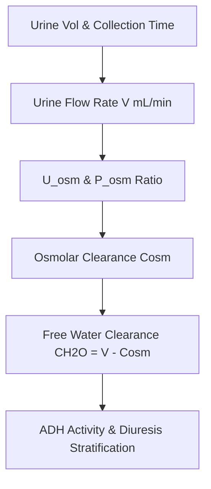

# Renal Free Water Clearance Personal Agent Skill

[](LICENSE)
[](https://www.python.org/)
[]()
[]()
[]()

Deterministic, zero-mock personal agent micro-skill for calculating Osmolar Clearance ($C_{\text{osm}}$), Free Water Clearance ($C_{\text{H}_2\text{O}}$), Solute-Free Water Reabsorption ($T^c_{\text{H}_2\text{O}}$), and Electrolyte-Free Water Clearance ($E\text{-FWC}$).

## Architecture



## Quickstart

```python
from client import FreeWaterClearanceClient

client = FreeWaterClearanceClient()
result = client.evaluate_water_clearance(
    urine_volume_ml=48.0,
    collection_duration_min=60.0,
    urine_osmolality_mosm_kg=850.0,
    plasma_osmolality_mosm_kg=290.0,
    urine_sodium_meq_l=90.0,
    urine_potassium_meq_l=45.0,
    plasma_sodium_meq_l=140.0
)
print(result)
```

## License

Apache-2.0
